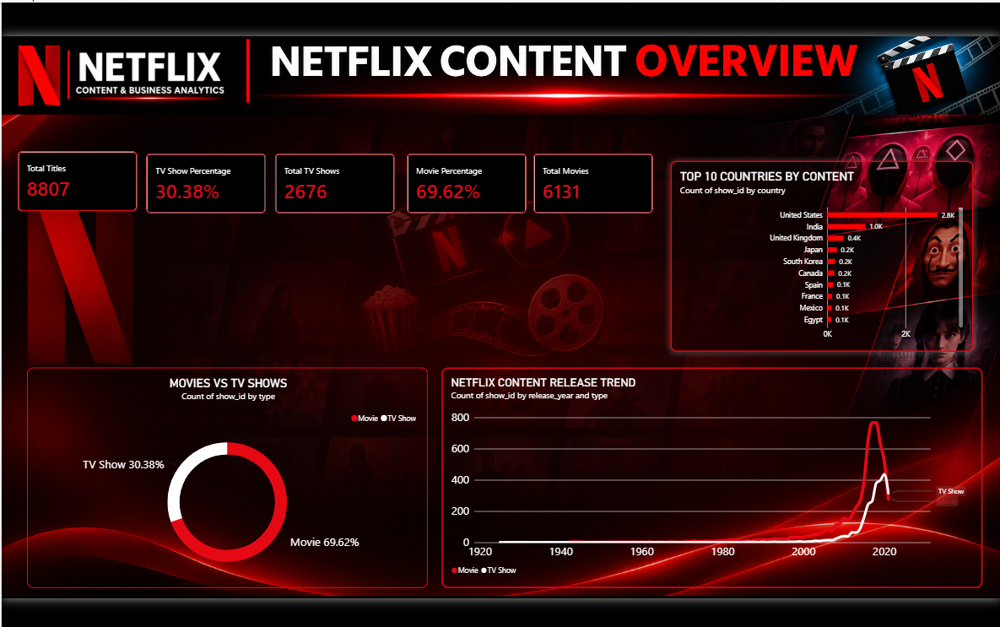

# 🎬 Netflix Content & Business Analytics

### End-to-End Data Analytics Project | Excel • MySQL • Python • Power BI

An end-to-end data analytics project focused on exploring Netflix's content catalog, identifying trends, and generating meaningful business insights using SQL, Python, Excel, and Power BI.

---

## 📊 Dashboard Preview

---

## 📌 Project Overview

This project analyzes Netflix Movies and TV Shows to understand content distribution, release trends, country-wise contributions, ratings, and genre patterns.

The objective is to transform raw Netflix data into meaningful business insights using multiple data analytics tools.

## 🎯 Project Objectives

- Analyze Movies and TV Shows distribution.
- Identify top content-producing countries.
- Explore content release trends over the years.
- Analyze ratings and genres.
- Perform data cleaning and preprocessing.
- Write advanced SQL queries for business analysis.
- Build interactive Power BI dashboards.

## 🛠️ Tools & Technologies

| Tool | Purpose |
|---|---|
| Excel | Data cleaning and preparation |
| MySQL | SQL queries and database analysis |
| Python | Exploratory Data Analysis (EDA) |
| Pandas | Data manipulation |
| Matplotlib | Data visualization |
| Seaborn | Statistical visualization |
| Power BI | Interactive dashboards |

## 📂 Dataset Overview

| Metric | Value |
|---|---:|
| Total Records | 8,807 |
| Total Columns | 12 |
| Movies | 6,131 |
| TV Shows | 2,676 |
| Unique Countries | 123 |

## 📈 Power BI Dashboards

The project includes five interactive dashboard pages:

1. Executive Overview
2. Content Analysis
3. Country Analysis
4. Ratings Analysis
5. Trends & Insights

## 🗄️ SQL Analysis

SQL queries cover:

- Total content analysis
- Movies vs TV Shows comparison
- Year-wise content analysis
- Country-wise content distribution
- Ratings analysis
- Genre analysis
- CTEs and Subqueries
- RANK and DENSE_RANK
- ROW_NUMBER
- LAG and LEAD
- Running totals
- Year-over-year growth analysis

## 🐍 Python Exploratory Data Analysis

Python was used to perform exploratory data analysis and create visualizations.

Key analysis areas:

- Netflix content distribution
- Genre analysis
- Ratings analysis
- Movie duration analysis
- TV Show seasons analysis
- Top 10 countries
- Yearly content trends

## 📊 Key Business Insights

- Movies represent approximately **69.62%** of the total content.
- TV Shows represent approximately **30.38%** of the total content.
- The dataset contains **123 unique countries**.
- The United States and India are among the leading content-producing countries.

## 📁 Project Files

| File | Description |
|---|---|
| Netflix_360_Analytics.pbix | Power BI Dashboard |
| Netflix_360_Analytics.pdf | Power BI PDF Report |
| Netflix_Dashboard_Overview.png | Dashboard Preview |
| Netflix_Advanced_SQL_Analysis.sql | Advanced SQL Queries |
| Netflix_Cleaned.csv | Cleaned Dataset |
| Netflix_Final.csv | Final Dataset |
| Netflix_MySQL_Import.csv | MySQL Import Dataset |
| import_to_mysql.py | MySQL Import Script |
| Project_Overview.docx | Project Documentation |
| Python EDA files | Analysis Scripts and Visualizations |

## 🚀 Project Outcome

This project demonstrates practical data analytics skills, including:

- Data cleaning and preprocessing
- Database management using MySQL
- Advanced SQL analysis
- Exploratory Data Analysis using Python
- Data visualization
- Interactive dashboard development using Power BI
- Business insights generation

## 👨‍💻 Author

**Sachin Kumar Chaudhary**

- GitHub: [sachinNot](https://github.com/sachinNot)
- Skills: Excel | SQL | Python | Power BI
- Field: Data Analytics

---

⭐ If you find this project useful, consider giving this repository a star!
